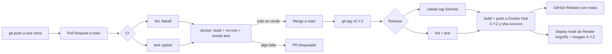

# devops-up

API REST que se conecta al demonio de Docker local (SDK oficial) para listar contenedores, consultar su consumo de CPU y memoria, y reiniciarlos o detenerlos.

Trabajo práctico integrador de DevOps · Universidad de Palermo

## Integrantes
- Risek Abucharara
- Matias Laboratto

## Requisitos
- Docker Desktop o Docker Engine
- Python 3.12 (solo para desarrollo local)

## Cómo ejecutar
```bash
docker compose up --build
```
La documentación interactiva queda en http://localhost:8000/docs

El compose levanta dos servicios:
- `api`: la API, con el socket `/var/run/docker.sock` montado para hablar con el demonio de Docker del host.
- `demo`: un nginx que sirve de contenedor de prueba para listar, medir, reiniciar y detener.

Para cambiar la configuración, copiar `.env.example` a `.env`. En Linux hay que poner en `DOCKER_GID` el GID del grupo `docker` (`getent group docker | cut -d: -f3`); en Docker Desktop alcanza con el valor por defecto.

### Sin Docker (modo simulador)
Con `BACKEND=simulator` la API usa contenedores ficticios en memoria. Sirve para desarrollar sin Docker y es el modo con el que corre en Render, donde no hay un demonio de Docker al que conectarse.

```bash
python -m venv .venv
.venv/bin/pip install -r requirements-dev.txt   # Windows: .venv\Scripts\pip
BACKEND=simulator .venv/bin/python -m app
```

### Variables de entorno
| Variable | Por defecto | Descripción |
|---|---|---|
| `BACKEND` | `docker` | `docker` (SDK real) o `simulator` |
| `PORT` | `8000` | Puerto HTTP |
| `LOG_LEVEL` | `INFO` | Nivel de los logs JSON |
| `APP_VERSION` | `dev` | Versión que muestra `/health`; el pipeline la graba en la imagen |
| `NEW_RELIC_LICENSE_KEY` | vacío | Activa el agente de New Relic |
| `NEW_RELIC_APP_NAME` | `devops-up` | Nombre de la app en New Relic |
| `DOCKER_GID` | `0` | Grupo dueño del socket de Docker (solo compose) |

## Endpoints
| Método | Ruta | Descripción |
|---|---|---|
| GET | /health | Estado de la API, versión y si el backend responde |
| GET | /containers | Lista contenedores activos |
| GET | /containers/{id}/stats | CPU y memoria del contenedor |
| POST | /containers/{id}/restart | Reinicia el contenedor |
| POST | /containers/{id}/stop | Detiene el contenedor |

`{id}` acepta el ID completo, un prefijo del ID o el nombre del contenedor, igual que el CLI de Docker. `restart` y `stop` reciben `?timeout=N` (0 a 60 segundos, por defecto 10) antes de forzar el apagado.

```bash
curl http://localhost:8000/containers
# [{"id":"3f4e8a1b2c9d","name":"devops-up-demo-1","image":"nginx:1.30.6-alpine","status":"running"}]

curl http://localhost:8000/containers/devops-up-demo-1/stats
# {"id":"3f4e8a1b2c9d","name":"devops-up-demo-1","cpu_percent":0.02,
#  "memory_usage_mib":9.81,"memory_limit_mib":7837.5,"memory_percent":0.13}

curl -X POST "http://localhost:8000/containers/devops-up-demo-1/restart?timeout=5"
# {"id":"3f4e8a1b2c9d","name":"devops-up-demo-1","action":"restart","status":"running"}
```

El cálculo de CPU y memoria replica el de `docker stats`: la CPU es la variación de uso del contenedor sobre la variación del sistema por la cantidad de CPUs, y a la memoria se le descuenta la caché de archivos (`inactive_file`).

| Código | Cuándo |
|---|---|
| 404 | El contenedor no existe |
| 409 | Se piden estadísticas de un contenedor detenido |
| 422 | Parámetro inválido (por ejemplo, `timeout` fuera de rango) |
| 502 | Docker rechazó la operación |
| 503 | No hay conexión con el demonio de Docker |

## Tests y linter
```bash
pip install -r requirements-dev.txt
pytest
flake8
```
Los tests no necesitan Docker: el SDK se reemplaza por dobles de prueba (`unittest.mock`) y el simulador.

## Flujo de trabajo
- `main` está protegida: todo cambio entra por Pull Request con al menos una revisión.
- Ramas: `feat/...`, `fix/...`, `ci/...`, `docs/...`.
- Commits según [Conventional Commits](CONTRIBUTING.md).
- Versionado según [SemVer](https://semver.org/lang/es/). Cada tag `vX.Y.Z` publica una imagen con ese tag en Docker Hub.

## Pipeline CI/CD



Los workflows son modulares: `lint.yml`, `tests.yml` y `docker.yml` son reutilizables (`workflow_call`) y los usan tanto `ci.yml` (en cada PR) como `release.yml` (en cada tag).

| Workflow | Disparador | Qué hace |
|---|---|---|
| `ci.yml` | PR y push a `main` | Lint, tests y build de la imagen |
| `release.yml` | Tag `v*` | Valida SemVer, repite lint y tests, publica en Docker Hub, crea la release y despliega |
| `lint.yml` | Reutilizable | `flake8` |
| `tests.yml` | Reutilizable | `pytest` |
| `docker.yml` | Reutilizable | Build, verificación de usuario no-root, smoke test de `/health` y push opcional |

### Componentes
| Rol | Herramienta |
|---|---|
| Runner de CI | GitHub Actions (`ubuntu-24.04`) |
| Linter | flake8 |
| Tests | pytest |
| Registro de imágenes | Docker Hub |
| Hosting | Render (servicio desde imagen, modo simulador) |
| Monitoreo | New Relic (APM + logs) |

### Configuración en GitHub
En *Settings > Secrets and variables > Actions*:

| Nombre | Tipo | Valor |
|---|---|---|
| `DOCKERHUB_USERNAME` | Variable | Usuario de Docker Hub. Es variable y no secreto para que el nombre de la imagen pueda pasarse al job de deploy. |
| `DOCKERHUB_TOKEN` | Secreto | Access token de Docker Hub con permiso de escritura |
| `RENDER_DEPLOY_HOOK_URL` | Secreto | Deploy hook del servicio en Render. Si falta, el deploy se omite con un aviso. |

En *Settings > Branches*, una regla para `main` con:
- *Require a pull request before merging* y 1 aprobación.
- *Require status checks to pass*: `lint / flake8`, `test / pytest` y `docker / build`.
- *Do not allow bypassing the above settings*.

### Render
Crear un *Web Service* desde imagen existente con `docker.io/<usuario>/devops-up:<versión>`, health check en `/health` y la variable `BACKEND=simulator` (Render no expone un demonio de Docker). El deploy hook solo puede cambiar el tag, así que el repositorio de la imagen tiene que ser el mismo que se configuró en el servicio.

## Monitoreo
_Pendiente: dashboard de New Relic y señales doradas._

## Decisiones de diseño
_Pendiente: imagen base, multi-stage, usuario non-root, estrategia de branching._
