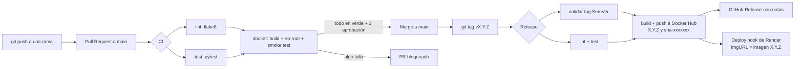
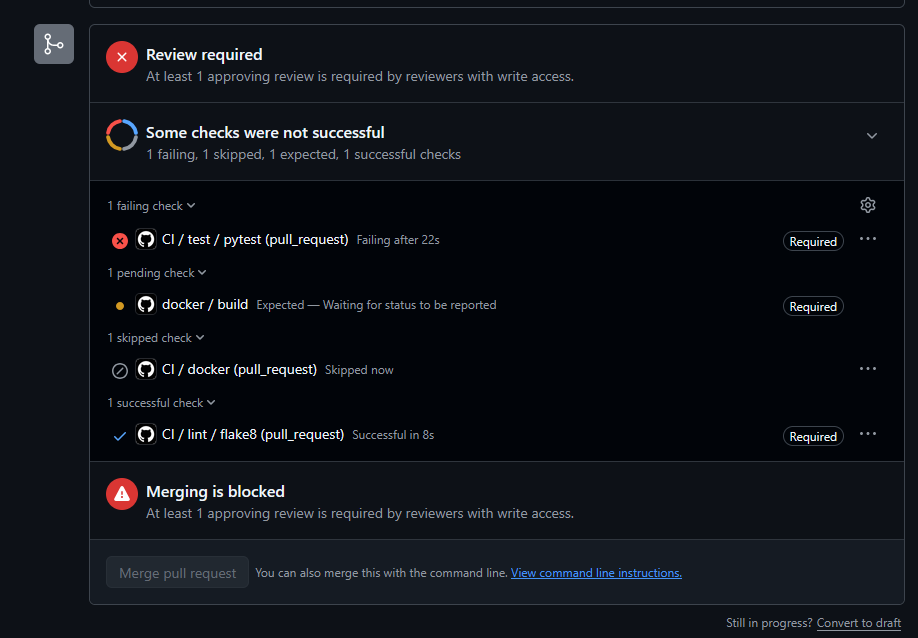
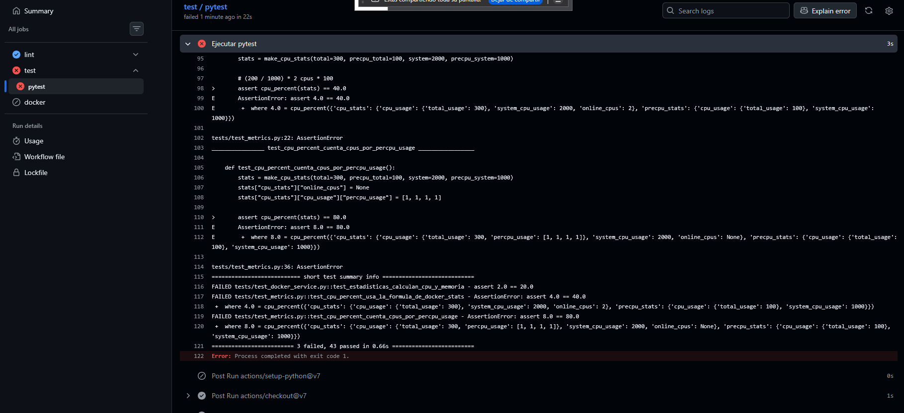
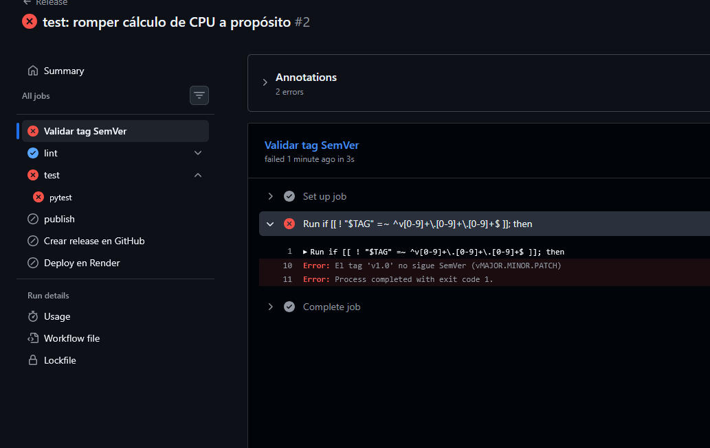

# Informe técnico: devops-up

**Trabajo Práctico Integrador: Ciclo de Vida y Despliegue Continuo de una API**
DevOps · Universidad de Palermo

| Integrante | GitHub |
|---|---|
| Risek Abucharara | [@Risekabu](https://github.com/Risekabu) |
| Matías Laboratto | [@Matilabo](https://github.com/Matilabo) |

Repositorio: https://github.com/Matilabo/devops-up · Imagen: [`matilabo/devops-up`](https://hub.docker.com/r/matilabo/devops-up)

---

## Índice
1. [Resumen del proyecto](#1-resumen-del-proyecto)
2. [Cumplimiento de la consigna](#2-cumplimiento-de-la-consigna)
3. [Arquitectura del pipeline](#3-arquitectura-del-pipeline)
4. [Justificación técnica y decisiones de diseño](#4-justificación-técnica-y-decisiones-de-diseño)
5. [Observabilidad y monitoreo](#5-observabilidad-y-monitoreo)
6. [Aplicación de la filosofía DevOps](#6-aplicación-de-la-filosofía-devops)
7. [Principios Lean: reducción de desperdicio](#7-principios-lean-reducción-de-desperdicio)
8. [Pendientes y próximos pasos](#8-pendientes-y-próximos-pasos)

---

## 1. Resumen del proyecto

`devops-up` es una API REST en **Python con FastAPI** que se conecta al demonio de Docker local mediante el **SDK oficial (`docker`)** para:

- listar los contenedores activos;
- consultar el consumo de CPU y memoria de un contenedor, con las mismas fórmulas que `docker stats`;
- reiniciar o detener un contenedor desde la API.

| Método | Ruta | Descripción |
|---|---|---|
| GET | `/health` | Estado de la API, versión y si el backend responde |
| GET | `/containers` | Lista contenedores activos |
| GET | `/containers/{id}/stats` | CPU y memoria del contenedor |
| POST | `/containers/{id}/restart` | Reinicia el contenedor |
| POST | `/containers/{id}/stop` | Detiene el contenedor |

La API tiene **dos backends** con la misma interfaz, que se eligen con la variable `BACKEND`:

- `docker`: usa el SDK real contra el socket de Docker. Es el modo del entorno local.
- `simulator`: usa contenedores ficticios en memoria. Sirve para correr la API donde no hay un demonio de Docker, como Render o el smoke test del CI.

Los errores de Docker se traducen a códigos HTTP: **404** si el contenedor no existe, **409** si se piden estadísticas de uno detenido, **502** si Docker rechaza la operación y **503** si no hay conexión con el demonio.

> 📷 _Agregar captura: Swagger en `/docs` con los cinco endpoints (`docs/img/swagger.png`, la misma de la diapositiva 2)._

### Stack
| Capa | Herramienta |
|---|---|
| Lenguaje y framework | Python 3.12, FastAPI, uvicorn |
| Acceso a Docker | SDK oficial `docker` 7.2.0 |
| Tests y linter | pytest, flake8 |
| Contenedores | Docker (multi-stage), Docker Compose |
| CI/CD | GitHub Actions |
| Registro de imágenes | Docker Hub |
| Hosting | Render |
| Monitoreo | New Relic (agente APM + logs) |

---

## 2. Cumplimiento de la consigna

| Fase | Requisito | Dónde se cumple | Estado |
|---|---|---|---|
| 1 | API REST | [`app/main.py`](../app/main.py), [`app/docker_service.py`](../app/docker_service.py) | ✅ |
| 1 | Pruebas unitarias | [`tests/`](../tests): 46 tests con pytest | ✅ |
| 1 | Documentación abierta (obligatorio) | Swagger en `/docs`; `/` redirige ahí | ✅ |
| 2 | Conventional Commits | Todo el historial (`feat:`, `fix:`, `test:`, `ci:`, `build:`, `docs:`…) | ✅ |
| 2 | Branching y Pull Requests | `main` protegida; 6 PRs integrados y 1 PR de experimento | ✅ |
| 2 | Versionado | SemVer con tags `vX.Y.Z`, más tag inmutable `sha-xxxxxxx` | ✅ |
| 3 | Multi-stage build | [`Dockerfile`](../Dockerfile): etapas `builder` y `runtime` | ✅ |
| 3 | Imagen base liviana, sin `latest` | `python:3.12.15-slim-trixie` | ✅ |
| 3 | Usuario no-root | UID/GID 10001, verificado en el CI | ✅ |
| 3 | Orden de capas para el caché | `requirements.txt` antes que el código | ✅ |
| 3 | `docker-compose.yml` | API + contenedor de demo con un solo comando | ✅ |
| 4 | CI modular en PRs con lint y tests | `ci.yml` + reutilizables `lint.yml`, `tests.yml`, `docker.yml` | ✅ |
| 4 | Publicación en Docker Hub con tag SemVer | `release.yml`: `matilabo/devops-up:1.0.0` | ✅ |
| 4 | CD con deploy hook y tag exacto (opcional) | Job `Deploy en Render` con `imgURL` | ⏳ Falta cargar el hook |
| 5 | Logs JSON (`timestamp`, `level`, `path`, `status_code`) | [`app/logging_config.py`](../app/logging_config.py) + middleware | ✅ |
| 5 | Plataforma de monitoreo | New Relic | ✅ |
| 5 | Dashboard propio con golden signals | Consultas NRQL en la [sección 5](#5-observabilidad-y-monitoreo) | ⏳ Falta la captura |

### Pull Requests
| PR | Título | Resultado |
|---|---|---|
| [#1](https://github.com/Matilabo/devops-up/pull/1) | feat: API de métricas de contenedores con Docker SDK | Integrado |
| [#2](https://github.com/Matilabo/devops-up/pull/2) | ci: lint y tests en cada pull request | Integrado |
| [#3](https://github.com/Matilabo/devops-up/pull/3) | feat: dockerizar la API con imagen multi-stage y docker compose | Integrado |
| [#4](https://github.com/Matilabo/devops-up/pull/4) | feat: logs estructurados en JSON y monitoreo con New Relic | Integrado |
| [#5](https://github.com/Matilabo/devops-up/pull/5) | ci: publicar imagen versionada en Docker Hub y desplegar en Render | Integrado |
| [#6](https://github.com/Matilabo/devops-up/pull/6) | docs: informe técnico, guía de contribución y README completo | Integrado |
| [#7](https://github.com/Matilabo/devops-up/pull/7) | test: romper cálculo de CPU a propósito | Cerrado sin integrar (experimento de falla) |

Cada PR usa la [plantilla del repositorio](../.github/pull_request_template.md): descripción, tipo de cambio, cómo se probó, evidencia y checklist.

---

## 3. Arquitectura del pipeline

### 3.1 Diagrama de flujo



### 3.2 Workflows

Los workflows son **modulares**: `lint.yml`, `tests.yml` y `docker.yml` son reutilizables (`workflow_call`) y los usan tanto `ci.yml` (en cada PR) como `release.yml` (en cada tag). Cada etapa está definida una sola vez y se comporta igual en los dos flujos.

| Workflow | Disparador | Qué hace |
|---|---|---|
| [`ci.yml`](../.github/workflows/ci.yml) | PR y push a `main` | Lint y tests en paralelo; el build de la imagen corre solo si los dos pasan |
| [`release.yml`](../.github/workflows/release.yml) | Tag `v*` | Valida SemVer, repite lint y tests, publica en Docker Hub, crea la release y despliega |
| [`lint.yml`](../.github/workflows/lint.yml) | Reutilizable | `flake8` |
| [`tests.yml`](../.github/workflows/tests.yml) | Reutilizable | `pytest`, con caché de pip |
| [`docker.yml`](../.github/workflows/docker.yml) | Reutilizable | Build, verificación de usuario no-root, smoke test de `/health` y push opcional |

**Ejecución real del CI.** Lint (6 s) y tests (14 s) corren en paralelo, y el build de la imagen (16 s) arranca recién cuando ambos pasan.

> 📷 _Agregar captura: grafo del run de CI con `lint / flake8`, `test / pytest` y `docker / build` en verde (`docs/img/ci-run.png`, la de la diapositiva 10)._

**Release `v1.0.0`.** El tag `v1.0.0` disparó el workflow `Release`, que terminó completo:

| Job | Resultado | Duración |
|---|---|---|
| Validar tag SemVer | ✅ | 2 s |
| lint / flake8 | ✅ | 7 s |
| test / pytest | ✅ | 14 s |
| publish / build (build + push) | ✅ | 25 s |
| Crear release en GitHub | ✅ | 5 s |
| Deploy en Render | ⚠️ Omitido con aviso: faltaba `RENDER_DEPLOY_HOOK_URL` | 2 s |

En Docker Hub quedaron dos tags de la misma imagen (55,9 MB comprimida):
- `1.0.0`: la versión SemVer, que es la que se despliega.
- `sha-bdce29c`: tag inmutable con el commit exacto de `main` del que salió, para trazabilidad.

La [release de GitHub](https://github.com/Matilabo/devops-up/releases/tag/v1.0.0) incluye el comando `docker pull docker.io/matilabo/devops-up:1.0.0` y las notas generadas a partir de los PRs.

### 3.3 Componentes
| Rol | Herramienta | Detalle |
|---|---|---|
| Control de versiones | Git + GitHub | `main` protegida por un ruleset |
| Runner de CI | GitHub Actions | `ubuntu-24.04` |
| Linter | flake8 | Configuración en [`.flake8`](../.flake8) (línea máx. 100, complejidad máx. 10) |
| Tests | pytest | 46 tests, sin depender de Docker real |
| Build de imagen | Docker | Multi-stage, imagen base fijada |
| Registro de imágenes | Docker Hub | Repositorio público `matilabo/devops-up` |
| Hosting | Render | Web Service desde imagen, `BACKEND=simulator` |
| Monitoreo | New Relic | Agente APM de Python + reenvío de logs |

### 3.4 Configuración de GitHub
| Nombre | Tipo | Uso |
|---|---|---|
| `DOCKERHUB_USERNAME` | Variable | Usuario de Docker Hub. Es variable, no secreto, para poder pasar el nombre de la imagen al job de deploy |
| `DOCKERHUB_TOKEN` | Secreto | Token de acceso de Docker Hub con permiso Read & Write |
| `RENDER_DEPLOY_HOOK_URL` | Secreto del environment `render` | URL del deploy hook. Si falta, el deploy se omite con un aviso en lugar de fallar |

---

## 4. Justificación técnica y decisiones de diseño

### 4.1 Optimización del contenedor

```dockerfile
ARG PYTHON_IMAGE=python:3.12.15-slim-trixie

FROM ${PYTHON_IMAGE} AS builder          # Etapa 1: dependencias
RUN python -m venv /opt/venv
COPY requirements.txt .                   # primero solo las dependencias...
RUN pip install -r requirements.txt       # ...así esta capa sale del caché

FROM ${PYTHON_IMAGE} AS runtime          # Etapa 2: ejecución
RUN groupadd --system --gid 10001 app && useradd --system --uid 10001 --gid app ... app
COPY --from=builder /opt/venv /opt/venv
COPY app ./app                            # el código va al final
USER 10001:10001
ARG APP_VERSION=dev
ENV APP_VERSION=${APP_VERSION}
HEALTHCHECK CMD ["python", "-m", "app.healthcheck"]
CMD ["python", "-m", "app"]
```

| Decisión | Por qué |
|---|---|
| **Imagen base `python:3.12.15-slim-trixie`** | Versión fijada hasta el patch y el sistema operativo: el build es reproducible y nunca usa `latest`. `slim` pesa una fracción de la imagen completa y, a diferencia de `alpine`, usa glibc, así que las dependencias se instalan como wheels precompiladas sin compilar nada. |
| **Multi-stage** | La etapa `builder` instala las dependencias en un virtualenv; la etapa `runtime` copia solo ese virtualenv y el código. La caché de pip y las herramientas de instalación no llegan a la imagen final. La imagen final suma unos 10 MB a la base (55,9 MB contra 45,4 MB comprimidos). |
| **Orden de capas** | `requirements.txt` se copia y se instala antes que el código. Un cambio en `app/` reutiliza la capa de dependencias desde el caché. `ARG APP_VERSION` va al final por el mismo motivo: cambiar la versión no invalida las capas anteriores. |
| **Usuario no-root** | La app corre como UID/GID 10001. El código es propiedad de root, así que el proceso puede leerlo pero no modificarlo. El CI verifica en cada build que `id -u` no sea 0. |
| **`HEALTHCHECK` sin `curl`** | `python -m app.healthcheck` consulta `/health` con `urllib`. No hace falta instalar `curl`, lo que achica la imagen y las herramientas disponibles para un atacante. |
| **`.dockerignore`** | Tests, documentación, `.git` y `.env` no entran al contexto de build: el build es más rápido y no se filtran credenciales. |

> 📷 _Agregar captura: `docker images` con `devops-up:dev` y `python:3.12.15-slim-trixie` (`docs/img/docker-images.png`, la de la diapositiva 6)._

**Acceso al socket de Docker.** Para que la API gestione contenedores, el compose monta `/var/run/docker.sock`. Como el proceso no es root, `group_add` le agrega solo el grupo dueño del socket (`DOCKER_GID`). Montar el socket equivale a dar control total del demonio, así que el backend `docker` está pensado para entornos locales o de prueba. En Render la API corre con el simulador.

### 4.2 Estrategia de integración

Usamos **trunk-based development con ramas cortas**: `main` es la única rama permanente y siempre está desplegable.

- **Ramas por tipo de cambio:** `feat/`, `fix/`, `ci/`, `docs/` y `test/` (por ejemplo, `feat/api-contenedores`).
- **Ruleset sobre `main`:**
  - no se puede pushear directo: todo entra por Pull Request;
  - hace falta **una aprobación** de un integrante distinto al autor;
  - las conversaciones de revisión tienen que estar resueltas;
  - los checks `lint / flake8`, `test / pytest` y `docker / build` son obligatorios;
  - solo se permiten **merge commits**, para conservar el historial con el autor de cada commit. Squash y rebase quedaron desactivados.
- **Conventional Commits** en todos los mensajes (ver [`CONTRIBUTING.md`](../CONTRIBUTING.md)).
- **SemVer:** las versiones se marcan con tags `vX.Y.Z` sobre `main`. `feat` sube MINOR, `fix` sube PATCH y un cambio incompatible sube MAJOR.

**Trazabilidad.** Una versión se puede seguir de punta a punta:
tag `v1.0.0` → commit `bdce29c` → imagen `matilabo/devops-up:1.0.0` (también `sha-bdce29c`) → `APP_VERSION=1.0.0` grabado en la imagen → `/health` responde `"version": "1.0.0"`.

> 📷 _Agregar captura: respuesta real de `/health` de la imagen publicada (`docs/img/health-1.0.0.png`). Para obtenerla:_
> ```bash
> docker run --rm -p 8000:8000 -e BACKEND=simulator matilabo/devops-up:1.0.0
> curl http://127.0.0.1:8000/health
> ```
> _La captura de la diapositiva 9 muestra el valor de ejemplo del esquema de Swagger, no una respuesta real._

### 4.3 Estrategia de pruebas

Los 46 tests son **unitarios**: el cliente del SDK de Docker se reemplaza por dobles de prueba (`unittest.mock`) y por el simulador.

- **Deterministas:** no dependen de qué contenedores haya corriendo ni de su consumo, que cambia segundo a segundo.
- **Cubren los errores:** se puede simular que el demonio está caído, que el contenedor no existe o que Docker rechaza la operación.
- **Sin efectos secundarios:** un test de `stop` no detiene contenedores reales.
- **Rápidos y portables:** corren en menos de un segundo, en cualquier máquina y en el runner del CI.

Cubren el cálculo de CPU y memoria, la traducción de errores a HTTP, los endpoints (incluido que Swagger esté expuesto), la configuración, los logs JSON, el healthcheck, el arranque de New Relic y el simulador. La integración con Docker real se probó a mano desde Swagger con Docker Desktop.

> 📷 _Agregar captura: `pytest -v` en verde (`docs/img/pytest.png`, la de la diapositiva 4)._

---

## 5. Observabilidad y monitoreo

### 5.1 Logs estructurados

Toda la salida de la API es una línea JSON por evento. Un middleware registra cada request con `timestamp`, `level`, `path`, `status_code`, `method` y `duration_ms`. El access log de uvicorn está desactivado para no mezclar formatos.

```json
{"timestamp": "2026-10-19T19:51:23.577+00:00", "level": "WARNING", "logger": "app.requests", "message": "GET /containers/nope/stats -> 404", "method": "GET", "path": "/containers/nope/stats", "status_code": 404, "duration_ms": 1.05}
```

El nivel sale del código de respuesta: 2xx y 3xx → `INFO`, 4xx → `WARNING`, 5xx → `ERROR`. Así, filtrar por `level = 'ERROR'` muestra directamente las fallas del servidor.

### 5.2 New Relic

Con `NEW_RELIC_LICENSE_KEY` definida, `python -m app` inicia el agente oficial **antes** de importar FastAPI y uvicorn, para que pueda instrumentarlos. Cada request queda registrada como una transacción web y los logs JSON se reenvían a New Relic. Sin la key, la API funciona igual sin reportar, así que los tests y el CI no necesitan credenciales.

Para generar tráfico de prueba, [`scripts/generar_trafico.py`](../scripts/generar_trafico.py) mezcla requests válidas con un 10 % de requests a un contenedor inexistente, que dan 404:

```bash
python scripts/generar_trafico.py --url http://127.0.0.1:8000 --segundos 300 --rps 5
```

### 5.3 Dashboard de golden signals

El dashboard se armó desde cero (*Dashboards > Create a dashboard*), sin plantillas, con un widget por señal:

| Señal | NRQL |
|---|---|
| Tráfico (RPM) | `SELECT rate(count(*), 1 minute) FROM Transaction WHERE appName = 'devops-up' TIMESERIES` |
| Latencia p50 / p95 (ms) | `SELECT percentile(duration * 1000, 50, 95) FROM Transaction WHERE appName = 'devops-up' TIMESERIES` |
| Errores 4xx / 5xx | `SELECT filter(count(*), WHERE http.statusCode >= 400 AND http.statusCode < 500) AS '4xx', filter(count(*), WHERE http.statusCode >= 500) AS '5xx' FROM Transaction WHERE appName = 'devops-up' TIMESERIES` |
| Logs de error | `SELECT count(*) FROM Log WHERE level = 'ERROR' TIMESERIES` |

> 📷 _Agregar captura: dashboard con tráfico generado (`docs/img/newrelic-dashboard.png`)._
> 📷 _Agregar captura: logs JSON en New Relic, con `path` y `status_code` como atributos (`docs/img/newrelic-logs.png`)._

---

## 6. Aplicación de la filosofía DevOps

### 6.1 Primera forma: flujo y consistencia

**¿Qué tareas manuales quedaron 100 % automatizadas?**

| Tarea | Antes (manual) | Ahora |
|---|---|---|
| Revisar estilo y errores | Revisión a ojo | `flake8` en cada PR |
| Ejecutar los tests | Acordarse de correrlos | `pytest` en cada PR y en cada release |
| Construir la imagen | `docker build` en la máquina de alguien | Job `docker / build` |
| Verificar seguridad básica | — | El CI comprueba que la imagen no corra como root |
| Comprobar que la imagen arranca | Levantarla a mano | Smoke test de `/health` |
| Validar la versión | — | El tag tiene que cumplir `vMAJOR.MINOR.PATCH` |
| Etiquetar y publicar | `docker tag` + `docker push` a mano | Tags `X.Y.Z` y `sha-xxxxxxx` automáticos |
| Notas de la versión | Escribirlas a mano | GitHub Release con notas generadas desde los PRs |
| Desplegar | Entrar a la plataforma y actualizar | Deploy hook con la imagen exacta |

Lo único manual es decidir cuándo hay una versión nueva: `git tag vX.Y.Z && git push origin vX.Y.Z`.

**¿Cómo se asegura que el entorno sea idéntico en desarrollo y en CI/CD?**
- El **mismo `Dockerfile`** construye la imagen de `docker compose`, la que prueba el CI y la que se publica.
- La imagen base está fijada hasta el patch y las dependencias tienen **versión exacta** en `requirements.txt`.
- La configuración entra solo por **variables de entorno** (`BACKEND`, `PORT`, `LOG_LEVEL`, etc.), no por archivos distintos por entorno.
- El deploy recibe el **tag exacto** de la imagen que pasó por el pipeline, no "la última".

### 6.2 Segunda forma: feedback rápido y Andon Cord

**¿En qué puntos el pipeline "corta el cable"?**

1. **Lint:** si `flake8` encuentra un error, el check `lint / flake8` falla y el PR no se puede integrar.
2. **Tests:** si falla un test, falla `test / pytest` y el PR no se puede integrar.
3. **Imagen:** `docker / build` depende de lint y tests (`needs`). Si alguno falla, el build ni arranca, y como el check es obligatorio, el PR queda bloqueado. Si la imagen no construye, corre como root o no responde `/health`, también falla.
4. **Release:** un tag que no sigue SemVer corta todo antes de publicar. Si lint o tests fallan, no se publica la imagen, no se crea la release y no se despliega.
5. **Revisión humana:** sin la aprobación de otro integrante, el merge sigue bloqueado aunque los checks estén en verde.

El feedback llega en menos de un minuto: el CI completo tarda unos 40 segundos.

**Visibilidad de fallos en producción.** Si la API empieza a responder 5xx o se pone lenta, New Relic lo muestra en dos señales:
- **Métrica:** el widget de errores 5xx y el de latencia p95 del dashboard.
- **Log:** las líneas con `level: ERROR`, buscables y graficadas en el widget de logs de error.

El siguiente paso es convertirlas en una **alerta** NRQL (por ejemplo, más de 5 respuestas 5xx en 5 minutos) que avise al equipo por mail.

### 6.3 Tercera forma: aprendizaje y simulación de fallos

#### Experimento 1: test roto en un Pull Request

**Qué hicimos.** En la rama `test/experimento-test-roto` cambiamos la fórmula de CPU en `app/metrics.py`: multiplicamos por `10` en lugar de por `100`. Abrimos el [PR #7](https://github.com/Matilabo/devops-up/pull/7) como si fuera un cambio normal.

**Qué esperábamos.** Que los tests detectaran el error y el PR no pudiera integrarse.

**Qué pasó.**
- `lint / flake8` pasó en 8 s: el código era sintácticamente correcto, el error era de lógica.
- `test / pytest` falló a los 22 s: **3 tests fallidos y 43 aprobados**. Los tres comparaban el porcentaje de CPU con un valor conocido y recibieron un resultado diez veces menor (`4.0 == 40.0`, `8.0 == 80.0` y `2.0 == 20.0`).
- `docker` se salteó, porque depende de que lint y tests pasen.
- GitHub marcó **Merging is blocked**. El check obligatorio `docker / build` quedó en *Expected — Waiting for status to be reported*: un check obligatorio que no corre tampoco cuenta como aprobado.
- Cerramos el PR sin integrarlo. `main` nunca recibió el código roto.





**Qué aprendimos.** El linter no alcanza para detectar errores de lógica: hacen falta tests que comparen contra valores conocidos. Además, encadenar el build con `needs` evita gastar minutos de CI construyendo una imagen de código que ya sabemos que está mal.

#### Experimento 2: versión con un tag inválido

**Qué hicimos.** Sobre el mismo commit roto, creamos y pusheamos el tag `v1.0`, que no cumple SemVer porque le falta el PATCH.

**Qué esperábamos.** Que el workflow `Release` se negara a publicar.

**Qué pasó.**
- `Validar tag SemVer` falló en 3 s con el mensaje `El tag 'v1.0' no sigue SemVer (vMAJOR.MINOR.PATCH)`.
- `test / pytest` también falló, porque el tag apuntaba al código roto del experimento 1.
- `publish`, `Crear release en GitHub` y `Deploy en Render` **no se ejecutaron**. En Docker Hub siguen estando solo `1.0.0` y `sha-bdce29c`: no se publicó ninguna imagen defectuosa.
- Borramos el tag después del experimento.



**Qué aprendimos.** La release tiene dos barreras independientes, el formato de la versión y la calidad del código, y cualquiera de las dos alcanza para frenarla. Por eso la release repite lint y tests aunque el código ya haya pasado por un PR: el tag puede apuntar a cualquier commit, no necesariamente a uno de `main`.

#### Experimento 3: Docker caído con la API en ejecución _(pendiente)_

**Qué vamos a hacer.** Correr la API fuera de Docker (`python -m app` con la key de New Relic), generar tráfico con `generar_trafico.py` y, a la mitad, cerrar Docker Desktop. Hay que correrla fuera de Docker porque, si corriera dentro de un contenedor, se caería junto con el demonio.

**Qué esperamos.** Que la API siga respondiendo, pero con **503** en los endpoints de contenedores; que `/health` informe `backend_available: false`; que los logs salgan con `level: ERROR`; y que en New Relic suba el widget de 5xx.

> 📷 _Agregar capturas y resultado: terminal del script con los 503, widget de 5xx en New Relic y logs `ERROR` (`docs/img/experimento-docker-caido-*.png`)._

#### Aprendizaje no planificado: el primer workflow

En el PR #2, que agregaba el CI, GitHub no ejecutó ningún check: la configuración de Actions estaba bien y no había ningún error en el YAML, pero el evento `pull_request` no disparó el workflow. El CI corrió por primera vez cuando el PR se integró y `ci.yml` llegó a `main`. Desde el PR #3 en adelante los checks corrieron solos en cada PR. Conclusión: conviene llevar a `main` la definición del pipeline lo antes posible, antes de depender de ella como barrera.

---

## 7. Principios Lean: reducción de desperdicio

| Desperdicio (*muda*) | Cómo aparecía | Cómo lo evita la solución |
|---|---|---|
| **Esperas** | Compilar, etiquetar y publicar la imagen a mano, dependiendo de que alguien tenga tiempo y la máquina configurada | El workflow de release hace todo a partir de un tag. En el CI, lint y tests corren en paralelo y el feedback llega en unos 40 segundos |
| **Defectos detectados tarde** | Un error de lógica que llega a `main` y se descubre en producción | Lint, tests y smoke test corren en cada PR, antes del merge. El experimento 1 lo muestra: el error se frenó en el PR |
| **Configuración manual de entornos** ("en mi máquina anda") | Instalar a mano Python, dependencias y Docker en cada máquina | `docker compose up --build` levanta todo igual en cualquier máquina, con versiones fijas |
| **Trabajo innecesario** | Construir y publicar imágenes de código que no pasó los tests | El build depende de lint y tests (`needs`) y la publicación depende de la validación del tag |

Además, el proyecto se entregó en **pequeños lotes**: 55 commits atómicos agrupados en PRs por tema (API, CI, Docker, observabilidad, release y documentación), cada uno revisado e integrado por separado.

---

## 8. Pendientes y próximos pasos

| Pendiente | Qué falta |
|---|---|
| Deploy en Render | Crear el Web Service desde `docker.io/matilabo/devops-up:1.0.0` con `BACKEND=simulator`, cargar `RENDER_DEPLOY_HOOK_URL` en el environment `render` y sacar una versión nueva para probar el deploy automático |
| Dashboard de New Relic | Captura con tráfico generado |
| Experimento 3 | Ejecutarlo y documentar el resultado |
| Capturas de la presentación | Guardar en `docs/img/` las capturas de Swagger, pytest, run de CI y `docker images` |
| Alerta | Crear una alerta NRQL sobre los 5xx (mejora sugerida) |
